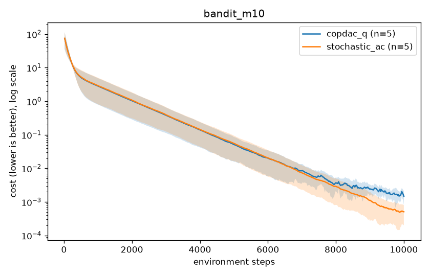
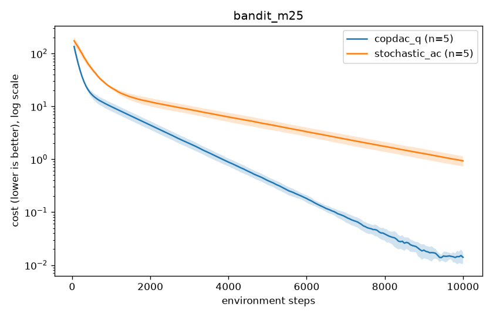
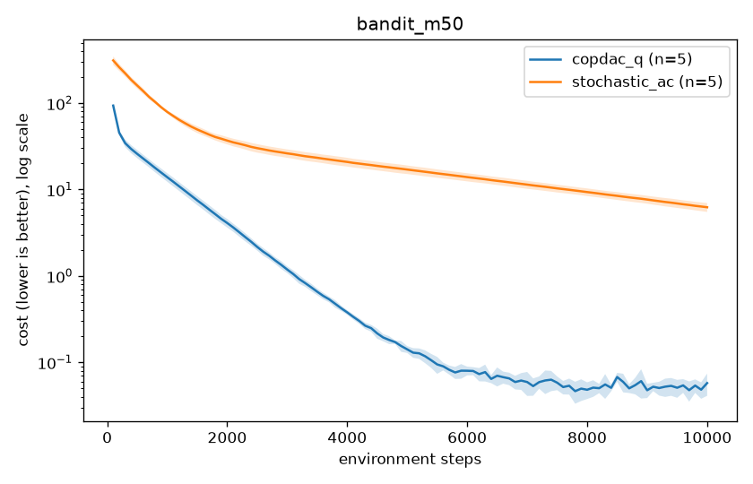
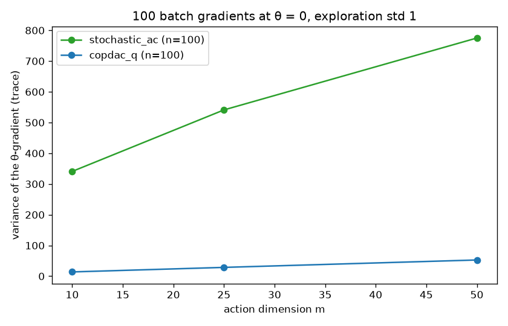
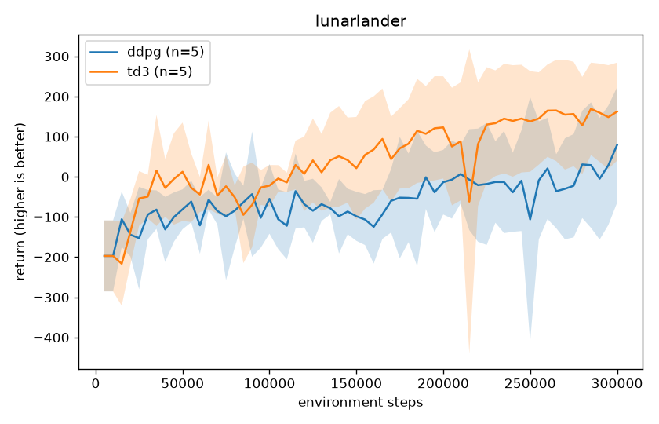

# Deterministic Policy Gradient Algorithms

Course project for **E1 277 Reinforcement Learning** (IISc, Aug–Nov 2026).
We study, implement and reproduce the main result of:

> D. Silver, G. Lever, N. Heess, T. Degris, D. Wierstra, M. Riedmiller.
> **Deterministic Policy Gradient Algorithms.** ICML 2014.
> PDF in this repo: [`paper/DeterministicPolicyGradientAlgorithms_Paper.pdf`](paper/DeterministicPolicyGradientAlgorithms_Paper.pdf)

We then follow the same idea forward to **DDPG** (Lillicrap et al., 2016) and **TD3** (Fujimoto et al., 2018).

---

## 1. The paper in five minutes

### The problem with stochastic policy gradients

For continuous actions, the usual approach is a stochastic policy $\pi_\theta(a|s)$ trained with the stochastic policy gradient theorem:

$$\nabla_\theta J(\pi_\theta) = \mathbb{E}_{s\sim\rho^\pi,\ a\sim\pi_\theta}\big[\nabla_\theta \log \pi_\theta(a|s)\, Q^\pi(s,a)\big]$$

This averages over **states and actions**, which has three costs:

1. **Integral over actions.** Estimating it needs more samples as the action dimension grows.
2. **Variance grows as the policy sharpens.** For a Gaussian policy the gradient variance grows like $1/\sigma^2$, so the estimate gets noisier exactly as the policy gets good (paper §6).
3. **Importance ratios off-policy.** Learning from a different behaviour policy $\beta$ needs the ratio $\pi/\beta$ in both actor and critic (OffPAC).

### The key idea: the deterministic policy gradient

Use a deterministic policy $a = \mu_\theta(s)$. The paper proves (Theorem 1):

$$\nabla_\theta J(\mu_\theta) = \mathbb{E}_{s\sim\rho^\mu}\big[\nabla_\theta \mu_\theta(s)\ \nabla_a Q^\mu(s,a)\big|_{a=\mu_\theta(s)}\big]$$

- The expectation is over **states only**. The actor moves its action uphill along the slope of $Q$.
- Theorem 2 shows it is the limit of the stochastic gradient as $\sigma \to 0$. So compatible critics, natural gradients and actor-critic methods all carry over.

### Exploring while learning a deterministic policy

A deterministic policy cannot explore. So the agent **acts** with a noisy behaviour policy $\beta = \mathcal{N}(\mu_\theta(s), \sigma_\beta^2)$ and **learns** $\mu_\theta$ off-policy.

- The actor needs no importance ratio, because there is no integral over actions.
- A Q-learning critic bootstraps with $\mu_\theta(s')$, so the critic needs none either.

### COPDAC-Q: the algorithm

The **compatible** critic $Q^w(s,a) = (a-\mu_\theta(s))^\top \nabla_\theta\mu_\theta(s)^\top w + V^v(s)$ has action-gradient $\nabla_\theta\mu_\theta(s)^\top w$. That is exactly what the actor needs, so substituting it for the true $Q$ does not bias the gradient (Theorem 3). It is learned with Q-learning (eqs. 19–22):

$$\delta_t = r_t + \gamma Q^w(s_{t+1}, \mu_\theta(s_{t+1})) - Q^w(s_t,a_t)$$
$$\theta \leftarrow \theta + \alpha_\theta \nabla_\theta\mu_\theta(s)\big(\nabla_\theta\mu_\theta(s)^\top w\big), \quad w \leftarrow w + \alpha_w \delta_t \phi(s,a), \quad v \leftarrow v + \alpha_v \delta_t \phi(s)$$

**Natural-gradient variant:** under the metric $\mathbb{E}[\nabla_\theta\mu\,\nabla_\theta\mu^\top]$, the actor step simplifies to $\theta \leftarrow \theta + \alpha_\theta w$.

### What came after (not in the paper)

- **DDPG:** the same actor gradient with neural networks, plus a replay buffer and slowly-updated target networks.
- **TD3:** fixes DDPG's tendency to overestimate $Q$ with three changes:
  - **Twin critics:** bootstrap from the smaller of two $Q$ estimates.
  - **Delayed actor updates:** one actor update every 2 critic updates.
  - **Target-policy smoothing:** clipped noise on the target action.

---

## 2. What this project implements

| Algorithm | File | Notes |
| --- | --- | --- |
| Stochastic Actor-Critic (Gaussian) | [`agents/stochastic_ac.py`](agents/stochastic_ac.py) | The paper's baseline on the bandit. Learns the mean and log-variance; least-squares compatible critic. Never abbreviated "SAC" (that name means Soft Actor-Critic). |
| COPDAC-Q | [`agents/copdac_q.py`](agents/copdac_q.py) | Compatible critic refit by least squares every $2m$ steps, one actor step per batch (paper §5.1). |
| Natural-gradient COPDAC | same file, `natural_gradient: true` | A flag on COPDAC-Q, not a separate agent. |
| DDPG and TD3 | [`agents/ddpg_td3.py`](agents/ddpg_td3.py) | One PyTorch class. TD3 = DDPG with its three flags switched on; every other setting is shared. |
| OffPAC | [`agents/offpac.py`](agents/offpac.py) | Planned add-on, not built (empty stub). |

| Environment | File | Used for |
| --- | --- | --- |
| Continuous quadratic bandit, $m = 10, 25, 50$ | [`envs/bandit.py`](envs/bandit.py) | Reproducing the paper's Figure 1: Stochastic AC vs COPDAC-Q. Cost $(a-a^*)^\top C (a-a^*)$, $a^* = [4,\dots,4]$, $C$ positive-definite with eigenvalues in $\{0.1, 1\}$, fixed by the seed. |
| LunarLanderContinuous-v3 (Gymnasium, Box2D) | built in [`run.py`](run.py) | DDPG vs TD3 on a harder task. |

**Experiment rules:**
- 5 seeds (0–4), reported as mean ± std.
- Evaluation always uses the policy **without** exploration noise. On the bandit that is the cost of the mean action, scored every $2m$ steps; on LunarLander, 5 episodes every 5,000 steps.
- Step sizes for the linear methods were swept on seed 0 only, as the paper did. The sweep is recorded in each config.

---

## 3. Results

All numbers below come from the CSVs in [`results/`](results/) via [`plots/out/results_table.md`](plots/out/results_table.md).

### 3.1 Bandit: the deterministic gradient wins by more as dimension grows

Final cost of the mean action after 10,000 steps (lower is better):

| Action dims $m$ | Stochastic AC | COPDAC-Q | COPDAC-Q advantage |
| --- | --- | --- | --- |
| 10 | 0.0005 ± 0.0003 | 0.0015 ± 0.0007 | tie (both near 0) |
| 25 | 0.93 ± 0.20 | 0.014 ± 0.004 | 66× lower |
| 50 | 6.23 ± 0.73 | 0.058 ± 0.017 | 108× lower |

| m = 10 | m = 25 | m = 50 |
| --- | --- | --- |
|  |  |  |

These curves have the same shape as the paper's Figure 1: the two methods meet at $m = 10$, and the gap opens at 25 and 50.

**Natural-gradient COPDAC:** on the bandit $\mu_\theta = \theta$, so $\nabla_\theta\mu_\theta = I$ and the natural update is the same as the ordinary one. Our 15 natural-gradient runs match COPDAC-Q to about $10^{-12}$, as expected.

### 3.2 Why: gradient variance (paper section 6)

We took 100 batch gradient estimates at a fixed parameter ($\theta = 0$, exploration std 1) and measured their variance (the trace of their covariance):

| $m$ | Stochastic AC | COPDAC-Q | ratio |
| --- | --- | --- | --- |
| 10 | 341 | 14 | 25× |
| 25 | 541 | 29 | 19× |
| 50 | 775 | 53 | 15× |



### 3.3 Extension: DDPG vs TD3 on LunarLander

300,000 steps, 5 seeds, identical hyperparameters except TD3's three flags:

| Agent | Final return (mean ± std) | Seeds ending above 200 | Wall-clock per run |
| --- | --- | --- | --- |
| DDPG | 79 ± 144 | 2 of 5 | ≈ 9.6 min |
| TD3 | 162 ± 122 | 3 of 5 | ≈ 10.9 min |



TD3 is ahead for most of training. The seed bands are wide, and neither mean crosses the "solved" line of 200 within 300k steps.

The longer write-up in [`reports/ddpg_td3_lunarlander_research_findings.md`](reports/ddpg_td3_lunarlander_research_findings.md) is based on an earlier experiment: 3 seeds and 200k steps. Its numbers therefore differ from the table above. It also includes a twin-critic disagreement analysis.

### 3.4 What we did not reproduce

- OffPAC was planned as an add-on but not built.

---

## 4. How to run it

### Setup

```bash
python -m venv .venv
# Windows: .venv\Scripts\activate    macOS/Linux: source .venv/bin/activate
pip install -r requirements.txt
pytest -q          # unit tests
```

LunarLander needs Box2D, which needs `swig` installed on the system first. On macOS: `brew install swig`. On Windows: `pip install swig`, or install it from swig.org.

### Train one run

`run.py` is the only training entry point:

```bash
python run.py --agent copdac_q      --env bandit      --seed 0 --steps 10000  --config configs/bandit_copdac_q_m10.yaml
python run.py --agent stochastic_ac --env bandit      --seed 0 --steps 10000  --config configs/bandit_stochastic_ac_m50.yaml
python run.py --agent copdac_q      --env bandit      --seed 0 --steps 10000  --config configs/bandit_copdac_q_natural_m25.yaml
python run.py --agent td3           --env lunarlander --seed 0 --steps 300000 --config configs/lunarlander_td3.yaml
```

Agents: `stochastic_ac`, `copdac_q`, `ddpg`, `td3`. Environments: `bandit`, `lunarlander`.

- **Where output goes:** each run writes `results/<env>/<agent>/seed<k>.csv`, with columns `step, eval_return, wall_time_sec`. It also writes `seed<k>.yaml` beside it, a copy of the exact config used.
- **Bandit folders:** bandit runs go to `results/bandit_m<m>/`.
- **Natural-gradient folders:** natural-gradient runs go to `copdac_q_natural/`.

Bandit runs take well under a second. A LunarLander run takes about 10 minutes on a CPU.

### Regenerate figures and the results table

```bash
python -m plots.make_plots                # learning curves + plots/out/results_table.md
python -m plots.bandit_gradient_variance  # gradient-variance CSV and figure
```

Nobody edits a CSV or a table by hand. Every number in this README comes from these scripts.

---

## 5. Repository map

```
paper/            the original 2014 paper (PDF)
envs/bandit.py    quadratic-cost continuous bandit
agents/           stochastic_ac, copdac_q (natural-gradient flag), ddpg_td3, offpac stub
common/           seeding, CSV logger, training loop, action-clipping wrapper
run.py            single training entry point
configs/          one YAML per agent × environment actually run
results/          CSV + resolved YAML for every run
plots/            make_plots.py, bandit_gradient_variance.py, generated figures in out/
reports/          DDPG vs TD3 write-up
tests/            pytest suite
compare_ddpg_td3.py, analyze_td3_*.py   extra LunarLander analysis scripts
spec.md           what must be built and why (the contract)
plan.md           how it was built: phases, decisions, fallbacks
task.md           task checklist with a note for every completed task
code.md           formula-level implementation contract
```

**Suggested reading order for newcomers:**
1. Section 1 of this README, then the paper (section 3–section 5 are the core).
2. `agents/copdac_q.py`, the shortest complete implementation of the paper's algorithm.
3. `spec.md` and `code.md`, if you want to change anything.

## 6. References

- D. Silver et al. *Deterministic Policy Gradient Algorithms.* ICML 2014.
- T. Degris, M. White, R. Sutton. *Off-Policy Actor-Critic.* ICML 2012.
- T. Lillicrap et al. *Continuous control with deep reinforcement learning (DDPG).* ICLR 2016.
- S. Fujimoto, H. van Hoof, D. Meger. *Addressing Function Approximation Error in Actor-Critic Methods (TD3).* ICML 2018.
- R. Sutton, A. Barto. *Reinforcement Learning: An Introduction.* MIT Press.
